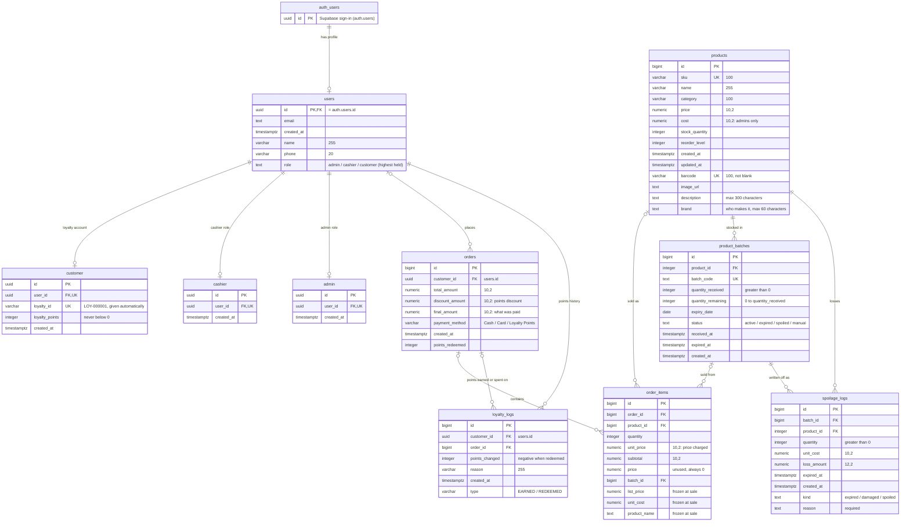

# SuperMarket Express: database ERD

The tables in the Supabase `public` schema, plus Supabase's own `auth.users`,
as of 2 Nov 2026, including `products.brand` (migration 20261102130000) and
member phone numbers (`set_member_phone`, migration 20261102140000). GitHub draws the
diagram below automatically; in VS Code, install a Mermaid preview extension
to see it.

Notation (crow's foot): `||` exactly one, `|o` / `o|` zero or one, `o{` zero
or many. PK = primary key, FK = foreign key, UK = unique.

## Relationships

| From → to | Through | Cardinality | If the parent is deleted |
|---|---|---|---|
| auth.users → users | `users.id` | 1 : 0..1 | profile deleted too |
| users → customer | `customer.user_id` | 1 : 0..1 | deleted too |
| users → cashier | `cashier.user_id` | 1 : 0..1 | deleted too |
| users → admin | `admin.user_id` | 1 : 0..1 | deleted too |
| users → orders | `orders.customer_id` | 0..1 : 0..* | order kept, member cleared |
| users → loyalty_logs | `loyalty_logs.customer_id` | 1 : 0..* | deleted too |
| orders → order_items | `order_items.order_id` | 0..1 : 0..* | deleted too |
| orders → loyalty_logs | `loyalty_logs.order_id` | 0..1 : 0..* | log kept, order cleared |
| products → order_items | `order_items.product_id` | 0..1 : 0..* | blocked while sold |
| product_batches → order_items | `order_items.batch_id` | 0..1 : 0..* | blocked while sold |
| products → product_batches | `product_batches.product_id` | 1 : 0..* | blocked |
| product_batches → spoilage_logs | `spoilage_logs.batch_id` | 1 : 0..* | blocked |
| products → spoilage_logs | `spoilage_logs.product_id` | 1 : 0..* | blocked |

"0..1" on the parent side means the foreign key column may be empty (null).
`order_items.order_id` and `product_id` allow null in the schema, but
checkout always fills them.

## Reading notes

- **Accounts and roles.** `users` is the app's copy of each Supabase sign-in.
  Everyone gets a `customer` row (their loyalty account); a row in `cashier`
  or `admin` adds that role.
- **Sales point at the account.** `orders.customer_id` and
  `loyalty_logs.customer_id` hold `users.id`, not `customer.id`.
- **Frozen sale lines.** A trigger (`order_items_snapshot_product`) copies
  `list_price`, `unit_cost` and `product_name` into each `order_items` row
  when it's saved, so editing a product later doesn't change past orders or
  profit. `unit_price` is what was actually charged (15% less for near-expiry
  units).
- **Private cost.** Only admins can read `products.cost` (column
  permissions); customers and cashiers see the price only.
- **Stock movement.** A sale lowers `products.stock_quantity` and each
  batch's `quantity_remaining`, soonest expiry first. Expired, damaged or
  spoiled units are recorded in `spoilage_logs` with their cost as the loss.
- **Payment method** is checked by the checkout function
  (`process_pos_checkout_base`), not by a table rule.
- **Unused column.** `order_items.price` is left over from an early version;
  checkout never fills it, so it's always 0.

## Database functions and triggers

The app reaches the tables through these functions; each one checks who is
calling before doing anything.

| Function | Used for | Who may use it |
|---|---|---|
| `process_pos_checkout` | Save a sale all-or-nothing and return the receipt | Customers (own sale only), cashiers, admins |
| `receive_stock` | Add a batch with its expiry date; also used for a new product's starting stock | Admins |
| `write_off_stock` | Remove damaged or spoiled units and log the loss | Admins |
| `process_expired_batches` | Remove expired stock and log the loss (also runs nightly at 12:05 AM Manila) | Admins |
| `get_product_inventory` | Stock, near-expiry units and earliest expiry per product | Signed-in users |
| `get_product_costs` | Product costs | Admins |
| `get_admin_sales_analytics` | Headline sales numbers | Admins |
| `get_profit_loss_series` | Orders, gross sales, costs and net income per hour, day or month | Admins (migration 20261102120000) |
| `get_sales_breakdown` | Payment mix and top products for a date range | Admins (migration 20261102120000) |
| `set_user_roles` | Give or take away the cashier and admin roles | Admins |
| `ensure_my_account` | Make sure a signed-in person has a profile and loyalty account | Signed-in users |
| `set_member_phone` | Save a member's phone number (a PH mobile number, one member per number), so the POS can find them by phone | Staff for any member; anyone for themselves |

| Trigger | On | What it does |
|---|---|---|
| `on_auth_user_created` | new sign-up (`auth.users`) | Sets up the new account (its `users` row and loyalty account) through `setup_customer_account` |
| `users_ensure_profiles` | `users` added or changed | Makes sure there's a `customer` row, plus an `admin` or `cashier` row when `users.role` says so |
| `products_assign_barcode` | `products` added or changed | Gives the product an in-store barcode |
| `products_create_initial_batch` | `products` added | Puts starting stock in a batch with no expiry date. The app no longer uses it: it adds products with 0 stock, then receives the starting stock with its expiry date |
| `order_items_snapshot_product` | `order_items` added | Freezes the line's normal price, cost and product name |
| `order_items_allocate_batches` | `order_items` added | Takes the units off the chosen batch, or the soonest-expiring ones (`consume_product_batches`) |
